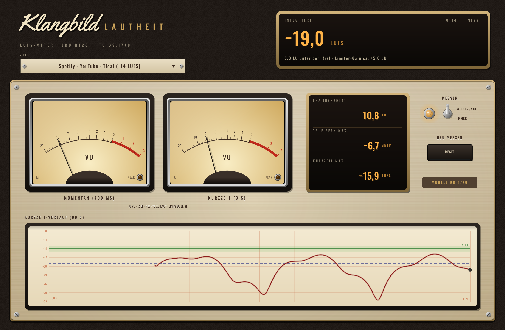

# Klangbild Lautheit

LUFS-Lautheitsmesser nach **ITU-R BS.1770-4 / EBU R128** im Vintage-Look – zeigt, ob dein Master
die Ziele von Spotify, Apple Music & Co. trifft. Audio Unit für Logic Pro (außerdem VST3 und
Standalone), gebaut mit [JUCE](https://juce.com). Das Plugin misst nur – der Klang bleibt bitgenau unverändert.



## Anzeigen

| Anzeige | Bedeutung |
|---|---|
| **Integriert** (groß, oben) | Lautheit des ganzen Songs – dieser Wert zählt fürs Streaming. Grün = Ziel ±1 LU getroffen. Darunter: Abstand zum Ziel und wie viel Limiter-Gain ungefähr fehlt |
| **Momentan** (VU links) | Lautheit der letzten 400 ms |
| **Kurzzeit** (VU rechts) | Lautheit der letzten 3 s |
| **LRA** | Lautheitsumfang (Dynamik) nach EBU Tech 3342 – Pop/Rock oft 4–8 LU, Akustik/Jazz mehr |
| **True Peak max** | höchste Spitze inkl. Zwischenwerte – rot, wenn über der Vorgabe des Ziels |
| **Kurzzeit max** | lauteste 3-s-Stelle |
| **Verlauf** | Schreiber mit der Kurzzeit-Lautheit der letzten 60 s, Ziellinie (grün) und integriertem Wert (gestrichelt) |

**Die VU-Zeiger stehen auf 0, wenn die Lautheit genau dem Ziel entspricht** – rechts davon zu laut, links zu leise.

## Bedienung
- **Ziel**: Spotify/YouTube/Tidal −14 · Apple Music/Podcast −16 · Deezer −15 · Amazon −14 (−2 dBTP) · Rundfunk EBU R128 −23 · CD/laut −9
- **Messen: Wiedergabe / Immer** – bei „Wiedergabe“ zählt der Gesamtwert nur, während Logic abspielt
  (Pause hält den Wert). Startest du **am Songanfang**, beginnt die Messung automatisch neu.
- **Reset**: Messung von vorn

## So benutzt du es
1. Als **letztes Plugin** auf die Summe (Stereo Out), hinter Klangbild Limit.
2. Ziel wählen, Song einmal **komplett von vorn** abspielen.
3. Integriert zu leise → Gain am Limiter erhöhen; zu laut → ist nicht schlimm, der Dienst regelt herunter
   (dann lieber Dynamik behalten). True Peak sollte unter −1 dBTP bleiben.

## Genauigkeit (eigene Tests nach EBU Tech 3341/3342)
| Test | Soll | gemessen |
|---|---|---|
| Sinus 1 kHz −23 dBFS (44,1 / 48 / 96 kHz) | −23,0 LUFS | −22,99 / −22,99 / −23,01 |
| Fall 3: −36/−23/−36 (relatives Gate) | −23,0 | −23,01 |
| Fall 4: −72/−36/−23/−36/−72 (absolutes Gate) | −23,0 | −23,01 |
| Fall 5: −26/−20/−26 | −23,0 | −22,98 |
| LRA Fälle 1–4 | 10 / 5 / 20 / 15 LU | 10,0 / 5,0 / 20,0 / 15,0 |
| True Peak Sinus fs/4, 45° (Sample-Peak 3 dB tiefer) | −6,0 dBTP | −5,9 |

## Installation in Logic Pro

Tab **Actions** → letzter grüner Lauf → **Artifacts** → `Klangbild-Lautheit-macOS`, dann:

1. `Klangbild-Lautheit-AU.zip` entpacken → `Klangbild Lautheit.component`
2. Finder → ⇧⌘G → `~/Library/Audio/Plug-Ins/Components` → Datei hineinkopieren
3. Einmal im Terminal:
   ```
   xattr -dr com.apple.quarantine ~/Library/Audio/Plug-Ins/Components/"Klangbild Lautheit.component"
   ```
4. Logic starten: **Audio Units → Klangbild → Klangbild Lautheit**

## Lizenzen

Schriften *Oswald* (OFL 1.1) und *Yellowtail* (Apache 2.0) – Lizenztexte in `Resources/`.
JUCE: AGPLv3 bzw. kommerziell – für den privaten Gebrauch unproblematisch.
